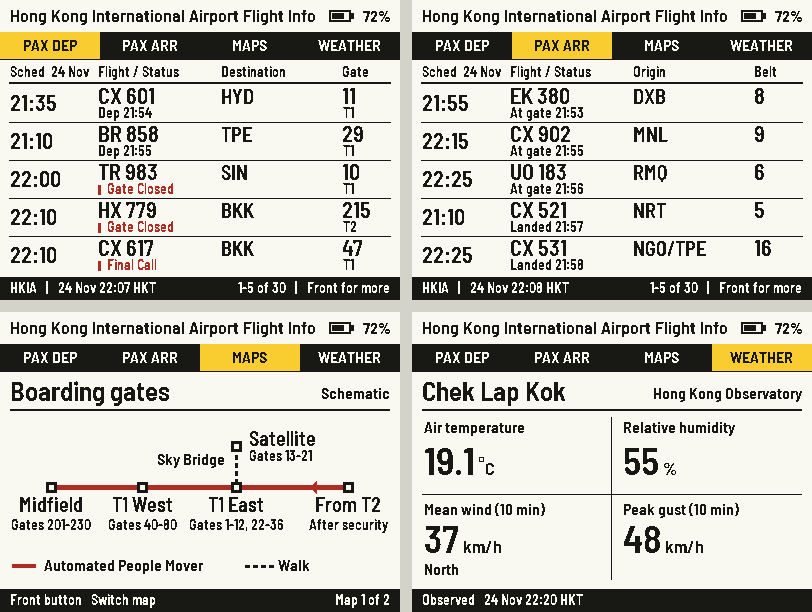

# Hong Kong International Airport Flight Info

The ZECTRIX NOTE4C shows four pages on its 400 × 300 four-color display. After Wi-Fi setup, it starts on **Pax Dep**. Press **Down** for the next page or **Up** for the previous page. The sequence wraps in either direction. The yellow tab marks the current page. All observation and flight times use Hong Kong time (UTC+8).

| Page | Information |
| --- | --- |
| 1 · Pax Dep | Passenger departures, destination airports, status, gate and terminal when supplied |
| 2 · Pax Arr | Passenger arrivals, origin airports, status, baggage belt and terminal when supplied |
| 3 · Airport Maps | Two offline schematics for boarding gates and ground transport |
| 4 · Airport Weather | HKO observations at Chek Lap Kok, including temperature, relative humidity, wind and gusts |



[Download the flashable firmware](firmware/NOTE4C-HKG.bin?raw=1) · [Airport maps](previews/airport-maps.png) · [Wi-Fi setup on the device](previews/wifi-setup-example.png) · [Wi-Fi setup on a phone](previews/wifi-network-picker.png)

## Install the supplied firmware

Use a **four-color NOTE4C Dev Kit, PCB v1.0**, with an ESP32-S3 N16R8 and SSD2683 panel. Installation replaces the running firmware and partition layout. The reference guide recommends backing up the entire 16 MiB flash first. [ZECTRIX NOTE4C quick start](https://wiki.zectrix.com/en/hardware/note4c/quick-start)

1. Connect a USB-C **data** cable. With esptool 5.x installed, replace `PORT` below with the device port, such as `/dev/cu.usbmodem…` on macOS or `COM4` on Windows. Use a new backup filename for each device.
2. Read and verify the backup before flashing. Keep the resulting 16,777,216-byte file for recovery.

   ```sh
   python3 -m esptool --chip esp32s3 --port PORT read-flash 0x0 0x1000000 note4c-original.bin
   python3 -m esptool --chip esp32s3 --port PORT verify-flash 0x0 note4c-original.bin
   ```

3. Open the updater in desktop Chrome or Edge. Select **NOTE4C-HKG.bin**, clear **Keep device settings** for the first install, and leave the updater’s Wi-Fi fields empty. Confirm address **0x0000**, install, and restart. The device handles Wi-Fi setup on its own screen. [ZECTRIX firmware updater](https://www.zectrix.com/en/firmware-updater.html)
4. Alternatively, install the same merged image with esptool 5.x from the directory containing the file.

   ```sh
   python3 -m esptool --chip esp32s3 --port PORT --baud 460800 write-flash 0x0 NOTE4C-HKG.bin
   ```

If the port is missing, hold the round **front BOOT** button, tap the left **RESET** pinhole, release BOOT, then select the port again. A normal reset returns to the dashboard. To restore the original firmware and settings, write the verified full-device backup to `0x0` on the same kit. [Espressif flash commands](https://docs.espressif.com/projects/esptool/en/latest/esp32s3/esptool/basic-commands.html)

The distributed merged image is 1,197,824 bytes. Its SHA-256 is `261232144bb8114d0ab35b485a281d0f2ae7aa4a48bec2c176a5d72a81381867`.

## Connect to Wi-Fi

On first boot, scan the **Wi-Fi QR code on the NOTE4C** with your phone camera and accept the invitation to join. It contains the temporary setup network name and its current WPA2 password. You can also join **HKG-Board-xxxx** manually with the password shown beside the code. Open `http://192.168.4.1` on your phone. The NOTE4C scans for visible **2.4 GHz** networks and lists them strongest first. Tap your network, enter the password if prompted and select **Save and restart**. The board opens passenger departures. Use **Scan again** for a fresh list or **Enter a network name manually** for a hidden network. The setup network uses WPA2 and a new password for each setup session. Home Wi-Fi details are stored in local flash.

On the device, **Up** and **Down** cycle between the QR code and groups of five nearby networks. The **front button** scans again when a network list is visible. Make the selection and enter the password on your phone, where names in Chinese and other scripts display in full. The e-paper font uses a question mark for unsupported characters. Open and WPA/WPA2/WPA3 Personal networks are selectable. Networks requiring other authentication appear with their support status. Repeated access points with the same name and security category share a row. The firmware starts with the Hong Kong Wi-Fi country setting and enables router-provided country information.

To change Wi-Fi or correct a password, hold the **upper side button**, tap RESET, and keep holding the upper button until the new Wi-Fi setup screen appears. Allow time for a full e-paper refresh. Four-color refreshes normally take more than ten seconds. [NOTE4C display and controls](https://wiki.zectrix.com/en/hardware/note4c/quick-start)

## Use the board

| Action | Result |
| --- | --- |
| Press and release the lower side button (Down) | Next page in the order Pax Dep → Pax Arr → Maps → Weather → Pax Dep |
| Press and release the upper side button (Up) | Previous page, wrapping from Pax Dep to Weather |
| Tap the front button on a flight page | Show the next five flights, wrapping back to the first group |
| Tap the front button on Maps | Switch between boarding gates and ground transport |
| Hold the front button for at least one second, then release on a flight or weather page | Fetch fresh information |

Each flight screen shows the scheduled time and date, first listed flight number, airport codes and status. A slash separates stops on a multi-airport route. Codeshares occupy one row per movement. A missing gate or belt appears as `--`. Red highlights cancellations, delays, diversions, final calls and closed gates.

The board keeps up to 30 flights per view. It orders them by the reported event time when available, including estimates and actual times, then by the feed’s order for ties. This lets a delayed flight stay visible when its scheduled time has passed. The window includes the last 15 minutes and the next 24 hours. Boarding, final-call and delayed flights without a recent event time remain eligible for up to six hours. When all five visible flights share a date, it appears above their times. A group spanning midnight shows the scheduled date under each time.

The NOTE4C checks the selected flight board every **60 seconds**. After three consecutive successful checks with the same visible flights and status, it checks every **120 seconds**. A visible change or a successful manual refresh restores the one-minute interval. The other passenger board uses its cached results until selected and due for a check. These are device polling intervals. In four live passenger-departure samples on 24 November 2026, the reported source timestamp advanced by 38, 54 and 27 seconds. Each response advertised a 30-second cache lifetime. [HKIA passenger departures](https://www.hongkongairport.com/en/flights/departures/passenger.page)

A yellow footer flags a feed warning, and urgent flight statuses carry a red marker and status text. A changed flight, gate, belt, page or feed warning triggers a screen update as soon as the board detects it. If only the timestamp has advanced, the next poll at least five minutes after the last completed redraw updates the footer. A manual refresh can update it sooner. The footer uses the airport’s update time, or **FETCHED** and the retrieval time when the feed omits a timestamp. **STALE FEED** flags an airport timestamp over 15 minutes old or unexpectedly in the future. If a request fails, the board keeps the last successful rows in RAM. Repeated failures use retry intervals of one minute, two minutes, then five minutes. A successful recovery returns to one-minute checks.

## Airport Maps

The boarding-gate schematic shows the Automated People Mover connections between T2, the T1 halls and the Midfield Concourse, plus the Sky Bridge walking connection to the Satellite Concourse. The ground-transport schematic shows terminal access from the Airport Express departures platform and the bus and taxi connections from T1 arrivals. Both maps show connections at schematic scale. Follow airport signs for individual gates, lifts and walking paths. [HKIA official map](https://www.hongkongairport.com/en/map/) · [HKIA passenger access guide](https://www.hongkongairport.com/en/passenger-guide/airport-facilities-services/special-needs-access) · [HKIA Terminal 2 access](https://www.hongkongairport.com/en/media-centre/news-stories-updates/HKIA_T2_Departure)

Both maps are built into the firmware. After Wi-Fi setup, the Maps page works even when the internet connection is down. Once the selected map is drawn, the dashboard waits for a button press. It pauses both flight and weather polling on this page. Tap the front button to switch maps. Down opens Weather and Up opens Pax Arr.

## Airport Weather

The weather page reads three Hong Kong Observatory regional datasets directly over HTTPS and selects the **Chek Lap Kok** station. Temperature is in degrees Celsius and humidity is a percentage. The wind section shows the ten-minute mean speed and direction and the maximum gust in km/h. Wind and gust share the wind observation time. A single observation time appears in the footer when all three reports are fresh, agree on the time and were retrieved successfully. Otherwise each reading has its own observation time or availability label. [HKO temperature](https://data.weather.gov.hk/weatherAPI/hko_data/regional-weather/latest_1min_temperature.csv) · [HKO humidity](https://data.weather.gov.hk/weatherAPI/hko_data/regional-weather/latest_1min_humidity.csv) · [HKO wind and gusts](https://data.weather.gov.hk/weatherAPI/hko_data/regional-weather/latest_10min_wind.csv)

The firmware checks HKO on entry if the cached reports are due, and every **ten minutes** while Weather is visible. This matches HKO’s published update frequency. A failed request marks the affected reading as cached, keeps its observation time and schedules a retry in two minutes. A missing first reading shows dashes. A reading older than 25 minutes or over five minutes ahead of the device clock is flagged as stale on evaluation. Identical screen contents skip the e-paper redraw. [HKO open data catalogue](https://www.hko.gov.hk/en/abouthko/opendata_intro.htm)

## Build from source

This standalone project was compiled with ESP-IDF **v5.5.3**. Activate that SDK and run these commands from the directory containing the top-level `CMakeLists.txt`. The project sets the target to `esp32s3` and supplies defaults for 16 MiB flash, octal PSRAM and native USB serial. [Espressif toolchain setup](https://docs.espressif.com/projects/esp-idf/en/v5.5.3/esp32s3/get-started/linux-macos-setup.html)

```sh
idf.py build
idf.py merge-bin -o NOTE4C-HKG.bin
```

For development on a kit already using this project’s partition layout, `idf.py -p PORT flash monitor` writes the separate build images and opens the USB serial log. Press Ctrl+] to leave the monitor.

## Hardware and data sources

The SSD2683 driver uses SPI3 in mode 0, the reference OTP initialization and a 30,000-byte framebuffer. Black, white, yellow and red use packed pixel values 0, 1, 2 and 3. It waits for active-low BUSY, puts the panel to sleep after a full refresh, and switches off its power rail. GPIO17 holds battery power on. [Pinned NOTE4C board source](https://github.com/LazyYoun/youn-ink-fourcolor-firmware/tree/8907e59300fde3b77a385dba9f3070b0de17b4c8/firmware/main/boards/zectrix-s3-epaper-4.2)

The battery icon and percentage sit at the upper right on all dashboard and device setup screens. The firmware averages ten calibrated readings from GPIO4 (ADC1 channel 3), accounts for the 2:1 divider and applies the NOTE4C reference voltage-to-percentage curve. Load and charging can affect this estimate. An unavailable reading displays `--%`. The icon updates when the screen would already redraw. Maps keeps its last reading while idle. [NOTE4C pin map](https://wiki.zectrix.com/en/hardware/note4c/quick-start) · [Reference battery calculation](https://github.com/LazyYoun/youn-ink-fourcolor-firmware/blob/8907e59300fde3b77a385dba9f3070b0de17b4c8/firmware/main/boards/zectrix-s3-epaper-4.2/zectrix-s3-epaper-4.2.cc#L491-L550)

While connected to a router, the Wi-Fi radio uses modem sleep between beacon checks. ESP-IDF dynamically lowers the CPU clock when idle. The dashboard task waits for a button or its next deadline between updates. [ESP-IDF power management](https://docs.espressif.com/projects/esp-idf/en/v5.5.3/esp32s3/api-reference/system/power_management.html)

The firmware requests the same public HTTPS service used by HKIA’s flight pages, with the Hong Kong date, English language, a two-day span, passenger flights only and the selected direction. It synchronizes time over NTP and validates the airport certificate using Espressif’s CA bundle. Live updates require internet access to NTP and the selected source, HKIA or HKO. The website feed can change independently of the firmware. [Passenger arrivals](https://www.hongkongairport.com/en/flights/arrivals/passenger.page) · [Passenger departures](https://www.hongkongairport.com/en/flights/departures/passenger.page)

## Verification

The firmware compiled and linked for ESP32-S3. A host test exercised the production parser and renderer with both HKIA passenger feeds captured on 24 November 2026. It also checked rejection of cargo and wrong-direction records, codeshares, missing fields, cross-midnight estimates, malformed responses, and preservation of a previous schedule after failure. A simulated clock and a 12-second panel refresh exercised the firmware’s main loop, including active and quiet polling, immediate gate and error redraws, delayed timestamp redraws, retry backoff, manual refresh and the four-page cycle. It held Maps idle for over 15 simulated minutes with zero network fetches or redraws, switched schematics, then exercised ten-minute weather polling, partial failure and recovery. Live HKO samples were checked for station selection, units, timestamps and handling of missing or regressing readings. The screen preview came from the same packed pixel buffers sent to the panel. An independent ZXing decoder recovered the matching network name and password from the 400 × 300 Wi-Fi setup framebuffer. A mobile-sized browser test exercised open and secured networks, non-ASCII names, unsupported entries, rescanning, manual entry and the save request. Host tests exercised bidirectional side-button navigation, the departure-first startup order, QR and network-list paging, scan deduplication and calibrated voltage conversion with simulated inputs. Layout checks covered a group spanning midnight, long routes, mixed weather timestamps, partial feed failures, a three-digit battery percentage, and low and unavailable battery readings. An independent QR decoder also checked the redesigned setup screen. The preview uses an illustrative 72% charge. Radio reception, physical buttons, battery accuracy and runtime still require testing with a connected NOTE4C.

The panel sequence derives from the MIT-licensed NOTE4C reference project. Barlow Semi Condensed is provided as monochrome glyphs under the SIL Open Font License. The corresponding notices are in `licenses/`.

The Wi-Fi QR encoder is the C implementation from Project Nayuki v1.8.0. Its MIT license is included in the vendored source files. [QR Code generator library](https://github.com/nayuki/QR-Code-generator/tree/720f62bddb7226106071d4728c292cb1df519ceb/c)
